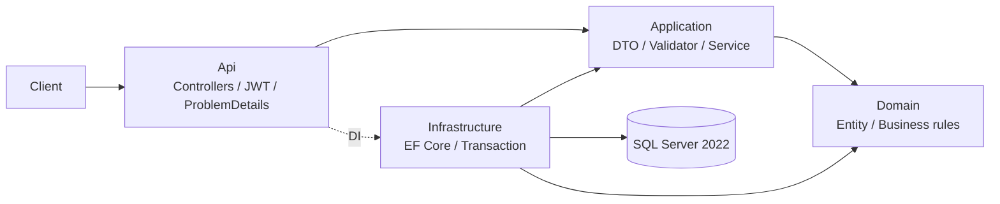

# Order & Payment Management API

[](https://github.com/hoangnguyen149/Order-Payment-Management-API/actions/workflows/ci.yml)

API portfolio dùng .NET 8, C# 12, ASP.NET Core Web API dạng controller, SQL Server 2022 và EF Core 8. Tài liệu và mã nguồn được tổ chức theo từng giai đoạn để có thể demo và giải thích các quyết định kỹ thuật khi phỏng vấn Junior Backend Developer.

Đã triển khai mã nguồn cho cả bốn giai đoạn: CRUD, JWT, tồn kho và báo cáo SQL; thanh toán mô phỏng với HMAC/idempotency/retry; outbox, đối soát và marketplace sync; Serilog, Docker, CI và kiểm thử. Các kiểm tra phụ thuộc SQL Server và phép đo hiệu năng chỉ được coi là xác minh khi chạy thực tế; xem [validation.md](docs/validation.md). Badge liên kết workflow, không phải tuyên bố CI đã chạy thành công.

## Kiến trúc



Đọc [quyết định kiến trúc](docs/architecture.md) để xem trách nhiệm từng lớp, transaction, cách giữ tồn và giới hạn của JWT demo. [Hướng dẫn Giai đoạn 1](docs/phase-1.md) có kịch bản tự kiểm tra và 5 câu hỏi phỏng vấn kèm gợi ý trả lời. [Giai đoạn 2](docs/phase-2.md) trình bày báo cáo, index, isolation và concurrency; [SQL tuning](docs/sql-tuning.md) chứa quy trình đo thật.

[Giai đoạn 3](docs/phase-3.md) giải thích gateway/jobs; [Giai đoạn 4](docs/phase-4.md) hướng dẫn vận hành và kiểm thử. Xem [sequence thanh toán](docs/payment-flow.md) và [idempotency/outbox](docs/idempotency-and-outbox.md) để hiểu transaction và các khoảng hở khi process dừng.

```text
src/OrderPayment.Api/             REST, cấu hình, xác thực
src/OrderPayment.Application/     DTO, validator, use case, persistence ports
src/OrderPayment.Domain/          Entity, tiền, quy tắc trạng thái
src/OrderPayment.Infrastructure/  EF Core, migration, SQL Server
src/OrderPayment.FakeExternalApi/ Gateway + marketplace mô phỏng, SQLite bền vững
tests/                           Unit test và integration test
requests/                        Request HTTP mẫu
docs/                            Giải thích và bài tập theo giai đoạn
```

## Chạy bằng Docker

Yêu cầu Docker Engine/Docker Desktop có Compose v2 và đủ tài nguyên cho SQL Server 2022. SQL Server image cần máy `linux/amd64`; máy ARM cần môi trường amd64 tương thích. Dùng Docker chỉ cho phát triển/demo, không triển khai nguyên cấu hình này lên production.

Từ thư mục gốc repository:

```bash
bash scripts/init-dev-env.sh
docker compose --env-file .env up --build -d
docker compose --env-file .env logs -f api
```

Script tạo `.env` được gitignore với khóa ký/mật khẩu ngẫu nhiên và giữ nguyên tệp đã có. Mở `.env` cục bộ để lấy thông tin đăng nhập demo; không đưa nội dung tệp vào Git hoặc log. API áp dụng migration lúc khởi động khi `Database__MigrateOnStartup=true`. API được publish tại `127.0.0.1:8080`, SQL Server tại `127.0.0.1:1433`; Swagger tại `http://localhost:8080/swagger` trong chế độ Development. Không dùng `EnsureCreated` thay cho migration.

Dừng dịch vụ mà giữ dữ liệu:

```bash
docker compose --env-file .env down
```

Xóa volume database là thao tác mất dữ liệu; chỉ làm khi muốn tạo lại dữ liệu demo.

## Chạy API bằng .NET SDK

Yêu cầu .NET SDK 8 phù hợp `global.json`, SQL Server 2022 và quyền tạo database/migration cho môi trường phát triển. Có thể chỉ khởi động service SQL bằng Compose rồi chạy API trên máy host.

Chạy nhanh trên host với SQL Server trong Docker:

```bash
bash scripts/init-dev-env.sh
docker compose --env-file .env up -d sqlserver
dotnet restore
dotnet build --no-restore
bash scripts/run-api.sh
```

Chờ SQL Server healthy trước khi chạy API; kiểm tra bằng `docker compose --env-file .env ps`. Chạy `bash scripts/run-fake-external.sh` trong terminal riêng để có gateway và marketplace tại cổng 8090. Script `run-api.sh` đọc `.env` cục bộ **đáng tin cậy**, ánh xạ secret sang biến cấu hình ASP.NET Core rồi chạy API tại cổng 8080 với migration được bật. Không source `.env` nhận từ nguồn không tin cậy. Script không in giá trị bí mật.

Nếu không dùng script, cấu hình thủ công bằng biến môi trường hoặc .NET user-secrets:

| Tên | Ý nghĩa |
| --- | --- |
| `ConnectionStrings__DefaultConnection` | Chuỗi kết nối SQL Server, có thông tin xác thực riêng cho môi trường |
| `Jwt__SigningKey` | Khóa ký đủ ít nhất 32 byte; giữ bí mật |
| `Jwt__Issuer` | Mặc định `OrderPayment` |
| `Jwt__Audience` | Mặc định `OrderPayment.Client` |
| `Auth__AdminUsername` | Tên Admin khởi tạo, mặc định `admin` |
| `Auth__AdminPassword` | Mật khẩu Admin, ít nhất 12 ký tự |
| `Auth__StaffUsername` | Tên Staff khởi tạo, mặc định `staff` |
| `Auth__StaffPassword` | Mật khẩu Staff, ít nhất 12 ký tự |
| `Database__MigrateOnStartup` | Bật `true` để chạy migration trong phát triển; mặc định không tự ý đổi schema |
| `Payments__WebhookSecret` | Khóa HMAC chung với mock host, ít nhất 32 byte UTF-8 |
| `Gateway__BaseUrl` | Mặc định host local `http://localhost:8090`; Compose dùng tên service mock |
| `Gateway__SimulationMode` | Development: `flaky`, `delay`, `timeout`, `always500`; bỏ trống để chạy bình thường |
| `Marketplace__BaseUrl` | Mặc định host local `http://localhost:8090` |
| `Jobs__Enabled` | Mặc định `true`; test tắt hosted loop và gọi processor trực tiếp |
| `Jobs__PollSeconds`, `Jobs__PendingPaymentMinutes`, `Jobs__MarketplaceIntervalSeconds` | Mặc định 30 giây, 2 phút, 120 giây |
| `Cors__AllowedOrigins__0` | Origin browser được cho phép; thêm index tiếp theo nếu cần |

Mock host đọc `Fake__AdminKey` (ít nhất 32 ký tự), `Fake__ApiBaseUrl`, `Fake__DatabasePath` và cùng `Payments__WebhookSecret`. Script `run-fake-external.sh` ánh xạ từ `.env`; Compose giữ SQLite trong volume `fake-data`. Secret quản trị mô phỏng không phải JWT của API.

Không commit giá trị bí mật vào `appsettings.json`. Với SQL Server container cục bộ, địa chỉ kết nối từ host là `localhost` cùng cổng SQL được publish; từ container API là tên service SQL. `TrustServerCertificate=True` chỉ phù hợp chứng chỉ tự ký của môi trường demo cục bộ.

Sau khi cấp cấu hình cho process:

```bash
dotnet restore
dotnet build --no-restore
dotnet run --project src/OrderPayment.Api
```

Ứng dụng không cung cấp đăng ký tài khoản công khai. Tài khoản Admin/Staff được khởi tạo từ cấu hình và hash bằng PasswordHasher trong bộ nhớ khi khởi động; chưa có database tài khoản, refresh token, reset mật khẩu hoặc thu hồi token. Đây là giới hạn của xác thực demo.

## API và cách thử

Đăng nhập `POST /api/auth/login` với JSON `{ "username": "...", "password": "..." }`. Response gồm `accessToken`, `expiresAt`, `role`. Dùng `Authorization: Bearer <accessToken>` cho API nghiệp vụ, hoặc nút **Authorize** trong Swagger.

| Endpoint | Quyền | Hành vi |
| --- | --- | --- |
| `POST /api/auth/login` | Anonymous | Lấy JWT |
| `GET /api/products`, `GET /api/products/{id}` | Admin, Staff | Danh sách/chi tiết sản phẩm |
| `POST /api/products` | Admin | Tạo sản phẩm |
| `PUT /api/products/{id}` | Admin | Cập nhật sản phẩm |
| `DELETE /api/products/{id}` | Admin | Xóa khi không bị dữ liệu đơn tham chiếu |
| `GET /api/customers`, `GET /api/customers/{id}` | Admin, Staff | Danh sách/chi tiết khách hàng |
| `POST /api/customers` | Admin | Tạo khách hàng |
| `PUT /api/customers/{id}` | Admin | Cập nhật khách hàng |
| `DELETE /api/customers/{id}` | Admin | Xóa khi không bị dữ liệu đơn tham chiếu |
| `GET /api/orders`, `GET /api/orders/{id}` | Admin, Staff | Danh sách/chi tiết đơn |
| `POST /api/orders` | Admin, Staff | Tạo đơn, giữ tồn, tính tiền trên server |
| `PUT /api/orders/{id}` | Admin, Staff | Thay nội dung đơn `Pending`, điều chỉnh tồn |
| `DELETE /api/orders/{id}` | Admin, Staff | Hủy đơn `Pending`, trả tồn; giữ bản ghi lịch sử |
| `PATCH /api/orders/{id}/status` | Admin, Staff | Chuyển `Paid → Shipped → Completed`; không tự đánh dấu Paid |
| `POST /api/orders/{id}/payments` | Admin, Staff | Tạo/retry payment bằng `Idempotency-Key`; Pending trả `202`, terminal replay trả `200` |
| `GET /api/orders/{id}/payments` | Admin, Staff | Danh sách payment của đơn |
| `POST /api/webhooks/payment` | HMAC | Nhận callback đã ký, chống tác động lặp |
| `GET /api/reports/revenue/daily` | Admin | Doanh thu theo ngày UTC, lọc thời gian/khách hàng |
| `GET /health` | Anonymous | Readiness có kiểm tra SQL Server |
| `GET /health/live` | Anonymous | Liveness của process |

Danh sách nhận `page`, `pageSize`, `search`, `sort`, `descending`; danh sách đơn nhận thêm `customerId`, `status`. Response phân trang gồm `items`, `totalCount`, `page`, `pageSize`. Kích thước trang từ 1 đến 100. `sort` hỗ trợ `name`, `sku`, `price`, `stockQuantity` cho sản phẩm; `fullName`, `email` cho khách hàng; `createdAt`, `totalAmount`, `status` cho đơn. Tên sort không phân biệt hoa/thường. `search` của đơn là GUID đầy đủ, của sản phẩm/khách hàng là chuỗi tìm kiếm. Validation từ chối tham số không hợp lệ thay vì chạy truy vấn không giới hạn.

Ví dụ JSON tạo sản phẩm:

```json
{ "name": "Bàn phím", "sku": "KB-001", "price": 125000, "stockQuantity": 10 }
```

Ví dụ tạo khách hàng:

```json
{ "fullName": "Nguyễn Văn An", "email": "an@example.com", "phone": "0901234567" }
```

Tạo/sửa đơn chỉ gửi `customerId` và `items` gồm `productId`, `quantity`. Tổng tiền, đơn giá và trạng thái không nhận từ client. Mỗi sản phẩm chỉ xuất hiện một lần trong đơn; gộp số lượng trước khi gửi. Giá và tên sản phẩm được chụp trên dòng đơn; đơn cũ giữ lịch sử giá. SKU sản phẩm và email khách hàng có unique index ở SQL Server.

`PUT` thay toàn bộ nội dung đơn `Pending` và chụp lại giá hiện tại cho các dòng mới. Chỉ đổi giá trong danh mục mà không sửa đơn sẽ không ảnh hưởng giá đã lưu trên đơn.

Giữ tồn ngay khi tạo `Pending`; hủy trả lại tồn trong cùng transaction với đổi trạng thái. `DELETE` đơn không xóa vật lý. Hủy một đơn đã `Cancelled` trả `204`, không hoàn tồn lần hai; hủy ở các trạng thái khác `Pending`/`Cancelled` trả `409`. `rowversion` bảo vệ trường hợp nhiều request tranh cùng lượng tồn. Hai request hủy đồng thời có thể nhận `409`; đọc lại trạng thái rồi thử lại DELETE, lượng tồn chỉ được hoàn một lần. HTTP `409` yêu cầu client đọc lại dữ liệu, không bảo đảm tự retry thao tác tạo đơn sẽ an toàn.

Tạo mới trả `201 Created` cùng `Location`, cập nhật trả `200`, xóa/hủy thành công trả `204`. Các lỗi trả `ProblemDetails`: `400` dữ liệu sai, `401` chưa xác thực, `403` thiếu quyền, `404` không tìm thấy và `409` xung đột. API không trả entity EF Core trực tiếp.

Dùng [requests/order-payment.http](requests/order-payment.http) trong REST Client hoặc nhập request từ đó vào Postman. Lấy ID trả về từ request trước cho request sau.

## Báo cáo và SQL Server nâng cao

`GET /api/reports/revenue/daily?from=2025-01-01&toExclusive=2025-02-01` nhận ngày UTC, bao gồm mốc `from` và loại trừ mốc `toExclusive`. Thêm `customerId` để lọc một khách hàng. Chỉ Admin được gọi. Khoảng truy vấn tối đa 366 ngày, không bổ sung dòng 0 cho ngày không có doanh thu. Kết quả có `date`, `orderCount`, `revenue`; chỉ cộng đơn `Paid`, `Shipped`, `Completed`, không coi đơn `Pending`, `Cancelled` hoặc `PaymentFailed` là doanh thu.

Báo cáo nhóm theo ngày tạo đơn `CreatedAt` UTC và **trạng thái hiện tại**, chưa phải ngày tiền thực nhận vì chưa có `PaidAt`. Vì vậy kết quả một ngày cũ có thể thay đổi khi trạng thái đơn đổi. API gọi stored procedure qua Dapper, dùng tham số hóa và truyền CancellationToken. Đơn mới vẫn Pending; chỉ callback/đối soát thành công mới chuyển sang Paid. Không có endpoint tự đánh dấu Paid để làm báo cáo có dữ liệu.

Chuẩn bị lab riêng, giữ nguyên database CRUD mặc định:

```bash
bash scripts/init-dev-env.sh
docker compose --env-file .env up -d sqlserver
bash scripts/run-sql-lab.sh 100000
```

Script dùng database `OrderPaymentBenchmark`, tự áp dụng migration, seed 100.000 đơn rồi đo truy vấn trước/sau index trên bảng lab riêng. Seed có ID xác định để chạy lại không nhân đôi; chạy trên database demo/benchmark/test, không đưa vào startup API. Công cụ ghi bằng chứng vào `artifacts/sql-tuning`, không tự bịa số liệu vào tài liệu. Để xem dữ liệu lab qua API, dừng API host trước đó rồi chạy:

```bash
SQL_DATABASE=OrderPaymentBenchmark bash scripts/run-api.sh
```

Mặc định API vẫn dùng database `OrderPayment`; seed lab không đổ 100.000 đơn vào database CRUD mặc định.

Xem [Giai đoạn 2](docs/phase-2.md) cho lệnh seed, migration và test; xem [docs/sql-tuning.md](docs/sql-tuning.md) cho truy vấn trước/sau, logical reads, execution plan và cách ghi kết quả. Không điền số hiệu năng khi môi trường chưa chạy được SQL Server.

## Kiểm thử

```bash
dotnet test
```

Lệnh trên chạy toàn bộ test, bao gồm integration test khởi động **SQL Server thật bằng Testcontainers**. Docker daemon phải hoạt động và có quyền tải image SQL Server. Không cần dùng database ứng dụng đang chạy; test tạo và dọn môi trường riêng. Thiếu Docker là lỗi prerequisite, không phải kết quả test pass.

Để làm việc nhanh khi chỉ sửa quy tắc thuần:

```bash
dotnet test tests/OrderPayment.UnitTests
```

Unit test kiểm tra tính tiền, quy tắc trạng thái, validation và service. Integration test kiểm tra authentication/role, REST, giá do server quyết định, transaction giữ/trả tồn và các lỗi API với SQL Server. Kết quả chạy thực tế được báo riêng trong phần bàn giao; danh sách test trong repository không đồng nghĩa mọi môi trường đã được xác minh.

Xem [kết quả xác minh và blocker của môi trường cloud](docs/validation.md) để phân biệt build, test HTTP, mock host và test SQL. SQL integration cần tải được image và thực sự hoàn thành các assertion.

Kiểm tra riêng HTTP pipeline, JWT, phân quyền, Swagger và validation mà không truy cập database:

```bash
dotnet test tests/OrderPayment.IntegrationTests --filter FullyQualifiedName~HttpPipelineTests
```

Kiểm tra mock host, HMAC callback, SQLite persistence và marketplace cursor mà không cần SQL Server:

```bash
dotnet test tests/OrderPayment.IntegrationTests --filter FullyQualifiedName~SimulatorTests
```

Các nhóm trên không thay thế test CRUD/concurrency, payment transaction, outbox và job trên SQL Server. Lệnh `dotnet test` đầy đủ vẫn yêu cầu Docker và chạy tất cả nhóm.

## Phạm vi và giới hạn

| Giai đoạn | Nội dung |
| --- | --- |
| 1 — đã triển khai | Khung solution, CRUD, DTO/validation, DI, JWT, Swagger, tồn kho và test nền tảng |
| 2 — đã triển khai mã | Migration/index, seed ≥100.000 đơn, công cụ đo execution plan/logical reads, báo cáo stored procedure/Dapper, kiểm thử concurrency; kết quả SQL phụ thuộc khả năng chạy database thật |
| 3 — đã triển khai mã | Fake Gateway, HMAC webhook, idempotency bằng unique constraint, retry/timeout, reconciliation, outbox, marketplace sync có checkpoint/lock |
| 4 — đã triển khai mã | Unit/HTTP/SQL tests, Serilog JSON và correlation ID, CORS/rate limiting/health, Docker/Compose, GitHub Actions và tài liệu |

Không có số liệu hiệu năng trước khi chạy phép đo thật. Outbox theo mô hình **at-least-once + idempotent processing**, không tuyên bố exactly-once. Tích hợp thanh toán là mô phỏng, không phải giải pháp thanh toán production. Mỗi đơn chỉ có một payment; chưa có retry bằng giao dịch mới sau Failed, partial payment, refund, nhiều loại tiền, broker hoặc email provider thật. Callback đến muộn sau hủy được gắn `RequiresReview`; không tự hoàn tiền hoặc hồi sinh đơn.

Khuyến nghị commit nhỏ theo Conventional Commits, ví dụ `feat: add idempotent payment webhook` và `test: cover concurrent stock reservation`. Các giới hạn và kết quả kiểm chứng được ghi riêng để người review đánh giá đúng phạm vi portfolio.
