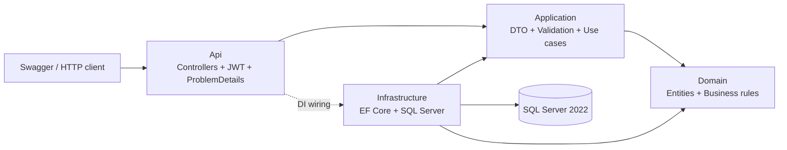
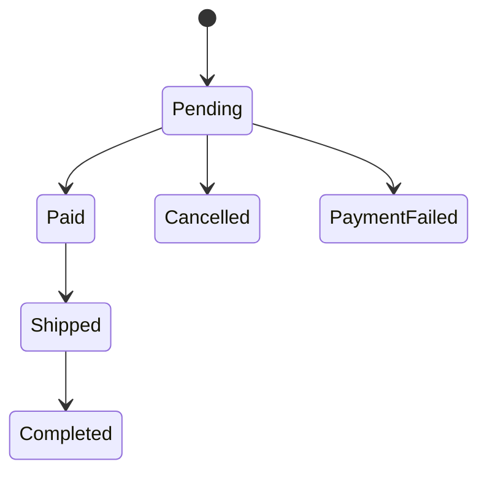

# Kiến trúc và quyết định kỹ thuật

## Phạm vi của Giai đoạn 1–4

API có xác thực, phân quyền, danh mục sản phẩm/khách hàng, đặt hàng, thanh toán, vận chuyển và hoàn tất đơn. EF Core quản lý ghi dữ liệu; báo cáo dùng Dapper/stored procedure, kèm công cụ seed và benchmark SQL Server riêng. FakeExternalApi mô phỏng gateway và marketplace với SQLite bền vững. Webhook, outbox và các job được triển khai để thực hành idempotency, transaction và phục hồi sau restart. Đây là dự án portfolio mô phỏng, không xử lý tiền thật.

Mũi tên giữa các project biểu diễn phụ thuộc khi biên dịch; Application gọi persistence qua interface và DI cung cấp implementation của Infrastructure lúc chạy.

| Lớp | Trách nhiệm | Không đặt ở đây |
| --- | --- | --- |
| Domain | Quy tắc trạng thái, tính tiền, bất biến của đơn và dòng hàng | HTTP, EF Core, chuỗi kết nối |
| Application | Use case, DTO, FluentValidation, interface truy cập dữ liệu | Controller, chi tiết SQL Server |
| Infrastructure | DbContext, mapping, transaction, lưu trữ, Dapper/stored procedure | HTTP response |
| Api | REST, JWT, phân quyền, DI, chuyển lỗi thành ProblemDetails | Tính tổng tiền từ dữ liệu client |

Không dùng CQRS/MediatR hay repository generic cho mọi entity. Các lớp hiện tại đủ nhỏ để đọc luồng controller → service → persistence, đồng thời tách được quy tắc nghiệp vụ để kiểm thử.

## Dữ liệu và tiền

- Dùng `decimal` cho giá và tổng tiền; SQL có precision rõ ràng. `double` dễ tạo sai số nhị phân khi cộng tiền.
- Client gửi mã sản phẩm và số lượng. Server đọc giá hiện tại rồi lưu giá tại thời điểm đặt hàng vào từng dòng đơn. Thay đổi giá sản phẩm sau đó không viết lại đơn cũ.
- `PUT` đơn `Pending` là thay toàn bộ các dòng hàng, giữ lại ID đơn nhưng chụp lại giá danh mục hiện tại. Quy tắc này đơn giản cho demo; hệ thống có báo giá cố định cần một chính sách sửa đơn riêng.
- Mỗi đơn có ít nhất một dòng và số lượng dương. Validation diễn ra trước thao tác lưu.
- API trả DTO để kiểm soát hợp đồng công khai, tránh vòng tham chiếu navigation và tránh cho client ghi các trường nội bộ.

## Tồn kho, transaction và cạnh tranh

Đặt đơn giữ tồn kho ngay ở trạng thái `Pending`. Cập nhật một đơn `Pending` điều chỉnh phần chênh lệch số lượng; hủy đơn trả lại lượng đã giữ. Hủy lặp một đơn đã `Cancelled` trả thành công mà không hoàn tồn lần hai. Cả thay đổi đơn lẫn thay đổi tồn kho phải được lưu trong cùng transaction.

`rowversion` của SQL Server là token cạnh tranh, không phải thời gian. EF Core đưa token đã đọc vào điều kiện cập nhật. Nếu hai request cùng đọc sản phẩm cuối cùng, chỉ request có token còn đúng mới ghi được; request còn lại phải nhận lỗi xung đột thay vì tạo tồn kho âm. Không chỉ dựa vào một câu `if (stock >= quantity)` trong bộ nhớ.

Đổi lại, client có thể cần tải lại dữ liệu và thử lại sau HTTP `409`. Không tự retry lệnh tạo đơn một cách mù quáng vì giai đoạn này chưa cung cấp idempotency key cho thao tác đặt đơn.

## Trạng thái đơn

Chỉ webhook hợp lệ hoặc đối soát mới chuyển đơn `Pending` thành `Paid`/`PaymentFailed`. PATCH trạng thái đơn chỉ nhận `Shipped` hoặc `Completed` và vẫn kiểm tra bước chuyển trong Domain; không cung cấp endpoint cho client tự đánh dấu `Paid`. Một khi có payment, sửa nội dung đơn bị từ chối để giữ nguyên số tiền đã chụp. Hủy đơn vẫn dùng khóa cùng với payment; callback đến muộn không hồi sinh đơn mà gắn `RequiresReview` và tạo sự kiện cần đối chiếu thủ công.

## Lỗi và bảo mật

- HTTP `400`: dữ liệu hoặc tham số truy vấn không hợp lệ; `404`: tài nguyên không tồn tại; `409`: xung đột nghiệp vụ/cạnh tranh; `401`: chưa xác thực; `403`: thiếu role.
- Các lỗi API dùng `ProblemDetails`, không trả stack trace hoặc chuỗi kết nối cho client.
- JWT có thời hạn, issuer, audience và chữ ký. Khóa ký và mật khẩu khởi tạo đọc từ cấu hình môi trường, không commit giá trị thật.
- Admin quản lý danh mục; Staff có quyền vận hành đơn hàng theo policy của controller. Swagger hỗ trợ nhập Bearer token để thử request.
- Tài khoản khởi tạo phù hợp cho demo; không thay thế hệ thống quản trị tài khoản, luân chuyển khóa và quy trình khôi phục mật khẩu của production.
- Báo cáo doanh thu chỉ dành cho Admin. Khoảng ngày UTC `[from,toExclusive)` giới hạn 366 ngày, lọc khách hàng tùy chọn; tham số truyền riêng qua Dapper, không nội suy SQL.

## Báo cáo và phòng thực hành SQL

EF Core tiếp tục xử lý CRUD và transaction. Một truy vấn báo cáo dùng Dapper để gọi stored procedure, giúp thể hiện rõ cột đọc, tham số và đường truy cập SQL mà không thêm một repository generic. Procedure dùng READ COMMITTED cho một SELECT; không cần mở transaction nhiều câu lệnh và không dùng NOLOCK. Một SELECT không có nghĩa là snapshot toàn bộ lịch sử: báo cáo có thể đổi khi các transaction khác commit.

Doanh thu ở đây là tổng đơn đang Paid/Shipped/Completed theo **ngày tạo đơn UTC**, không phải sổ kế toán theo ngày nhận tiền. Chưa có PaidAt trong mô hình. Không join OrderItems khi cộng Order.TotalAmount để tránh nhân tổng tiền theo số dòng hàng.

Index `(CustomerId,CreatedAt)` include Status/TotalAmount phục vụ lọc khách hàng; index CreatedAt include CustomerId/Status/TotalAmount phục vụ khoảng ngày toàn bộ khách hàng. Đổi lại tăng dung lượng và chi phí mỗi lần ghi. `OPTION(RECOMPILE)` cho phép chọn plan theo việc có lọc khách hàng hay không, với chi phí compile mỗi lần gọi. Chỉ đo trên workload thật mới kết luận được lợi ích.

Tools seed lịch sử mô phỏng trong database có hậu tố Demo/Benchmark/Tests và chỉ chạy khi bật flag tường minh. Không tự seed khi API khởi động. Benchmark chỉ nhận database hậu tố Benchmark, dùng bảng phụ của công cụ và không gỡ index của bảng Orders đang phục vụ API. Xem [Giai đoạn 2](phase-2.md) và [SQL tuning](sql-tuning.md).

## Kiểm thử và giới hạn

Unit test tập trung vào quy tắc nghiệp vụ và validation. Integration test dùng `WebApplicationFactory` cùng SQL Server thật do Testcontainers khởi chạy, nhằm kiểm tra cả mapping, transaction và ràng buộc SQL. Không thay SQL Server bằng EF InMemory để kết luận về cạnh tranh hoặc transaction.

Kết quả chạy SQL/seed/đo plan và test payment/jobs được ghi riêng trong [xác minh](validation.md), không suy ra từ việc build thành công. Xem [luồng thanh toán](payment-flow.md) và [idempotency/outbox](idempotency-and-outbox.md) để hiểu các khoảng hở giữa SQL và HTTP. JSON log dùng Serilog, correlation ID theo request và không ghi payload, secret hoặc thông tin khách hàng từ thông báo lỗi SQL.
