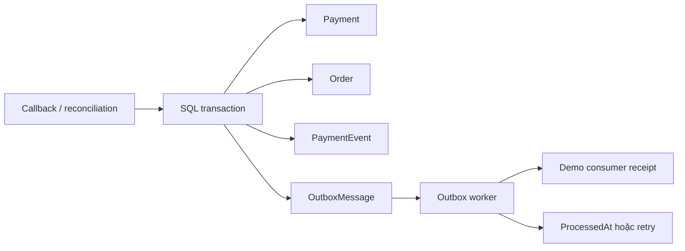

# Idempotency, transaction và outbox

## Ba định danh giải quyết ba vấn đề

| Định danh | Phạm vi | Tác dụng |
| --- | --- | --- |
| `Idempotency-Key` | Yêu cầu tạo payment | Client retry một ý định mà không tạo thêm giao dịch |
| `PaymentReference` | Giao dịch API ↔ gateway | Gateway nhận diện cùng giao dịch qua nhiều lần thử HTTP |
| `EventId` | Callback | Một thông báo được gửi lại không gây thêm tác động nghiệp vụ |

Kiểm tra tồn tại trong code giúp trả kết quả nhanh, nhưng không ngăn được hai request cùng thấy “chưa có”. Unique index ở SQL Server phân xử race; code xử lý lỗi constraint rồi đọc kết quả đã lưu hoặc trả conflict phù hợp. Tác động Payment, Order, PaymentEvent và OutboxMessages phải commit cùng một transaction.

Key có phạm vi theo OrderId. Trong cùng một đơn, retry cùng key trả về giao dịch đã lưu; key khác xung đột với giới hạn một payment cho mỗi đơn của demo. Hai đơn khác nhau có thể dùng cùng chuỗi key. Việc so sánh key cần nhất quán giữa validation, lookup và collation/index; không tùy tiện đổi chữ hoa/thường hoặc trim key khiến hai ý định bị nhập làm một.

## Vì sao ghi outbox cùng transaction?

Nếu đổi Order thành Paid rồi gửi email trực tiếp, process có thể dừng sau commit và trước khi gửi. Nếu gửi email trước commit, email có thể thông báo một đơn sau đó rollback. Outbox lưu ý định phát sự kiện cùng thay đổi nghiệp vụ; sau commit một worker đọc và chuyển đi.

Hệ thống theo **at-least-once delivery + idempotent processing**, không tuyên bố exactly-once. Worker có thể dừng sau khi consumer đã nhận nhưng trước khi đánh dấu outbox đã xử lý; lần chạy sau có quyền gửi lại. Consumer demo lưu receipt theo MessageId với unique constraint. Consumer gửi email hoặc gọi dịch vụ ngoài thật cũng cần dedupe/idempotency riêng; transaction SQL trong API không biến tác động từ xa thành atomic.

Outbox giữ số lần thử, thời điểm thử tiếp và lỗi đã được rút gọn. Một lỗi không được làm biến mất cả batch; bản ghi chưa xử lý tiếp tục được thử lại theo chính sách. Khóa phân tán dùng SQL Server để tránh hai instance xử lý cùng vòng job. Lock không thay thế constraint hoặc consumer idempotency khi process mất kết nối ở thời điểm không chắc chắn.

## Marketplace sync và checkpoint

Mock marketplace trả đơn có ExternalId, UpdatedAt và các dòng SKU/số lượng. Job đọc theo cửa sổ thời gian và phân trang, upsert theo ExternalId duy nhất. Checkpoint lưu trong database để restart không quay về điểm bắt đầu từ bộ nhớ.

Checkpoint chỉ được tiến khi trang/cửa sổ đã được xử lý theo hợp đồng của client. Một bản ghi lỗi phải có dữ liệu và định danh đủ để lưu vào SyncFailures rồi xử lý lại; không âm thầm bỏ qua vì các bản ghi khác đã thành công. Chạy lại một cửa sổ hoặc trang phải không tạo thêm đơn cho cùng ExternalId. Dùng distributed lock theo job để tránh hai instance tranh checkpoint, nhưng vẫn cần unique constraint cho dữ liệu đầu vào.

Đơn từ marketplace cũng phải tính giá trên server, kiểm tra SKU và giữ tồn theo domain rules. Dữ liệu ngoài không được phép tự đặt TotalAmount, giả mạo trạng thái Paid hoặc ghi thẳng vào bảng bỏ qua quy tắc.

## Giới hạn cần hiểu

- Demo consumer chỉ mô phỏng phát sự kiện, không tích hợp email provider hoặc message broker.
- Retry không đồng nghĩa thành công chắc chắn. Cần quan sát lỗi kéo dài, hàng đợi tồn và các bản ghi cần xử lý thủ công.
- Job nên có metric/alert, lịch sử vận hành và chính sách lưu trữ riêng khi dùng production. Hangfire hoặc một worker service riêng là hướng mở rộng, không bắt buộc để hiểu mô hình này.
- SQL Server transaction không bao trùm HTTP, một marketplace hoặc một dịch vụ gửi email bên ngoài.

Đọc [payment-flow.md](payment-flow.md) để xem trình tự gateway và [validation.md](validation.md) để phân biệt mã đã viết với hành vi đã kiểm chứng.
