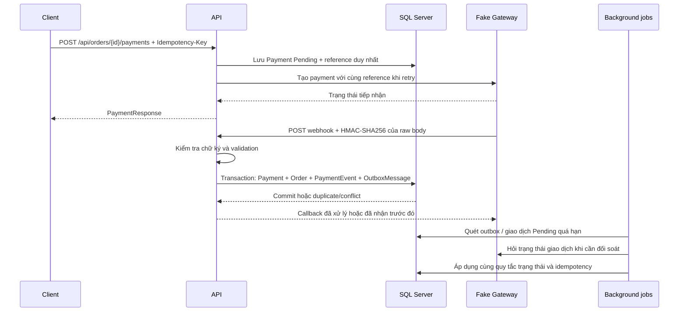

# Luồng thanh toán mô phỏng

Gateway trong repository là hệ thống mô phỏng phục vụ học tập, không xử lý tiền thật. API quản lý một đơn vị tiền tệ thống nhất bằng `decimal(18,2)`; đây chưa phải thiết kế đa tiền tệ. Không đưa thông tin thẻ vào API này.

## Tạo giao dịch và retry

Client gửi `Idempotency-Key` khi tạo thanh toán. Một key đại diện cho đúng một ý định tạo payment của một đơn; client phải giữ lại key khi retry sau timeout. Reference là mã do server sinh và không đổi khi gọi gateway lại. Unique constraint ở SQL Server là lớp bảo vệ cuối cùng khi nhiều request đến đồng thời.

Lưu ý timeout không chứng minh gateway chưa nhận giao dịch. Client không được tự tạo key mới ngay khi không nhận được phản hồi. Cơ chế retry có giới hạn số lần, exponential backoff và timeout; chỉ retry các lỗi tạm thời được cấu hình. Việc giữ reference ổn định cho phép gateway trả cùng kết quả cho các lần thử lại.

Không giữ database transaction mở trong khi chờ HTTP từ gateway. Nếu process dừng giữa bước lưu Pending và gọi gateway, job đối soát có thể phát hiện giao dịch còn chờ; đây là một khoảng hở có chủ ý và phải được xử lý bằng retry/reconciliation, không bằng khóa SQL xuyên qua network.

## Webhook

Endpoint `POST /api/webhooks/payment` không dùng JWT. Gateway ký chính xác các byte UTF-8 của JSON bằng HMAC-SHA256 với `Payments__WebhookSecret`, gửi hex trong header `X-Payment-Signature`. Đổi khoảng trắng, thứ tự thuộc tính hoặc nội dung sau khi ký sẽ làm chữ ký sai. API so sánh chữ ký theo cách tránh rò rỉ thời gian so sánh và giới hạn kích thước body.

Payload gồm `eventId`, `paymentReference`, `status` (`Succeeded` hoặc `Failed`) và `amount`. API đối chiếu số tiền đã lưu trên giao dịch, không tin số tiền callback để sửa tổng đơn. Không log raw body, chữ ký, khóa ký hoặc thông tin xác thực.

Callback lặp với cùng `eventId` là một lần giao hàng lại. Callback mang event khác nhưng thanh toán đã đạt trạng thái cuối không được phép trả đơn từ Paid về PaymentFailed. Callback thành công đến sau khi đơn đã hủy không được làm đơn sống lại hoặc bán lượng tồn đã trả cho người khác. API cần ghi nhận hoặc từ chối theo quy tắc trạng thái, không ép cập nhật vì gateway báo thành công.

HMAC xác nhận nguồn biết khóa và tính toàn vẹn payload. EventId cùng constraint chống tác động lặp; đây chưa phải cơ chế xác thực của cổng thanh toán production với rotation, timestamp window, audit và xử lý hoàn tiền.

## Đối soát

Job lấy các Payment còn Pending quá ngưỡng cấu hình rồi hỏi gateway. Kết quả cuối được áp dụng qua cùng đường xử lý nghiệp vụ với webhook, tránh hai bộ quy tắc khác nhau. Có khóa SQL theo job để các instance không cùng thực hiện một vòng đối soát. Lỗi tạm thời được giữ lại để vòng sau thử tiếp; log chỉ dùng định danh kỹ thuật.

Reconciliation bảo vệ tình huống mất callback, không thay thế kiểm tra sổ cái hoặc đối soát ngân hàng. Thành công đến muộn cho đơn đã hủy cần quy trình bù/hoàn tiền của hệ thống production; demo không tự phát sinh lệnh hoàn tiền.

## Cách kiểm tra

Chạy Compose theo README, tạo đơn Pending rồi gọi API tạo payment với một key ổn định. Dùng endpoint quản trị của mock host để chuyển trạng thái và gửi callback theo hướng dẫn trong file `.http`. Thử lại cùng callback 2–5 lần và song song, sau đó kiểm tra danh sách payment, trạng thái đơn và các test SQL tương ứng.

Các integration test thực hiện HMAC trên raw body và gọi API thật với SQL Server Testcontainers. Đọc [validation.md](validation.md) để biết chúng đã chạy thành công trong môi trường hiện tại hay còn bị chặn bởi prerequisite.
